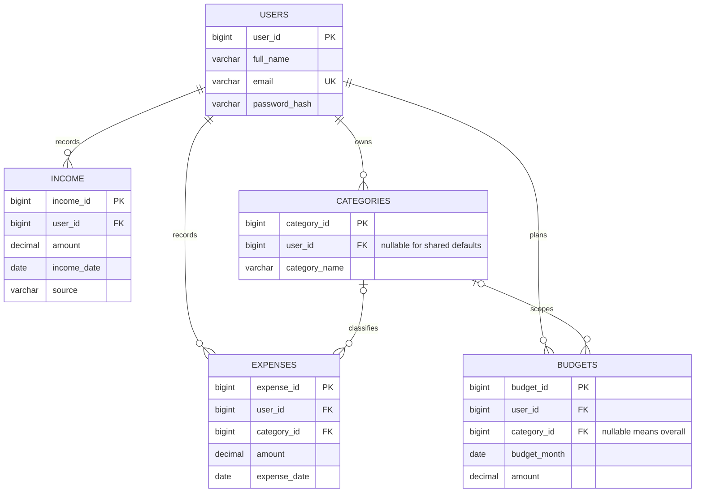

# Academic Project Report

## Abstract

The Personal Expense & Budget Management System is a database-backed web application for recording personal income and expenses. It lets an authenticated user classify spending, plan monthly limits, review transaction history, and inspect monthly and category-level reports. Flask handles requests and validation, while MySQL stores the relational data and enforces key integrity. Passwords are stored as salted hashes. Financial queries are parameterised and scoped by the signed-in user.

## Problem statement

People often record spending in scattered notes or spreadsheets, making it difficult to calculate balances, understand spending patterns, or notice when a planned limit is nearly used. A central system is needed to maintain consistent financial records and summarise them accurately.

## Objectives

1. Store user, income, expense, category and budget data in a relational database.
2. Provide secure account registration and login.
3. Support complete income and expense CRUD operations.
4. Compare actual spending with monthly and category budgets.
5. Provide searchable history, visual reports and downloadable CSV output.
6. Demonstrate relational constraints, joins, aggregates, views, triggers, procedures, indexes and transactions.

## Requirements

### Functional

- Register, sign in and sign out.
- Create, list, edit and delete income and expense entries.
- Set overall or category-specific monthly budgets and remove them.
- Filter and sort the combined transaction history.
- View dashboard totals and charts; export transaction data as CSV.

### Non-functional

- Keep credentials outside source code and use password hashing.
- Use prepared/parameterised SQL for user input.
- Restrict financial records to their owner.
- Enforce relationships and positive monetary values in MySQL.
- Provide responsive, readable pages and clear feedback.

## ER model

## Relational schema

- `Users(user_id PK, full_name, email UNIQUE, password_hash, created_at)`
- `Categories(category_id PK, user_id FK NULL, category_name, is_default)`; NULL owner denotes a shared default category.
- `Income(income_id PK, user_id FK, source, amount, income_date, description, created_at)`
- `Expenses(expense_id PK, user_id FK, category_id FK, amount, expense_date, description, created_at)`
- `Budgets(budget_id PK, user_id FK, category_id FK NULL, budget_month, amount, category_key)`; a generated key gives overall budgets a uniqueness sentinel.

## Normalisation

- **1NF:** Each cell stores one value. Repeated entries are separate rows, not lists embedded in a user record.
- **2NF:** Each table uses a single-column primary key; every non-key attribute describes that row's full key. Transaction data is kept outside the user row.
- **3NF:** User credentials and profile values live only in `Users`; category names live in `Categories`; income, expense and budget facts reference these entities by keys. Descriptive category data is not copied into each expense.

## Keys and integrity

Primary keys uniquely identify rows. Foreign keys connect transaction records to their user and category, with cascades for user deletion. `email` is unique. Positive-value CHECK constraints reject zero or negative amounts, and the budget check requires the first day of a month. Indexes on owner/date, owner/category/date and owner/amount support common dashboard and history filters. Category-owner triggers reject a user's attempt to associate an expense with another user's private category.

## SQL concepts demonstrated

- **INNER JOIN:** Expense rows joined to categories produce category labels and totals.
- **LEFT JOIN:** Budget rows left-joined to expenses retain budgets with zero spending.
- **GROUP BY / ORDER BY:** Monthly and category summaries group records and rank totals.
- **Aggregates:** `SUM` calculates totals; `AVG` and `COUNT` are shown in the supplied academic query examples.
- **Subquery:** An example returns expenses above the user's average expense.
- **View:** `monthly_summary` combines income and expense totals by user and month.
- **Stored procedure:** `sp_monthly_totals(user, month)` returns the two monthly totals.
- **Triggers:** Database-side checks verify expense and budget category ownership.
- **Transactions:** `database.execute_transaction` commits a group of statements together or rolls them back when one fails. Single writes also commit atomically.
- **Indexes:** Composite indexes cover common user/date and user/category searches.

The executable SQL examples are at the end of `database/expense_management.sql`. Replace `?` in those illustrative examples with the corresponding user ID in Workbench (or bind it in a client); Flask uses `%s` placeholders with values passed separately.

## Important code sections

- `database.py` creates a small MySQL connection pool. `query` executes parameterised SQL and rolls back if an error occurs.
- `app.py` contains routes. The `login_required` decorator checks the session, and each data route includes the current user's ID in its SQL.
- `valid_amount` uses decimal arithmetic to reject invalid values before they reach the database.
- The dashboard/report queries use aggregates and joins; the browser renders returned values with Chart.js.
- Templates display data and send forms to Flask routes. `script.js` fills edit dialogs and draws charts from server-provided JSON.

## Future scope

Add recurring transactions, custom category creation, multiple currencies, receipt attachment, scheduled budget reminders, optional MFA, account data export/import, and deployment behind a production WSGI server. A future schema version could support shared household budgets through explicit membership/role tables.
